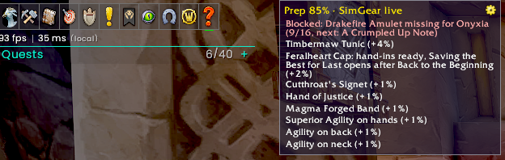
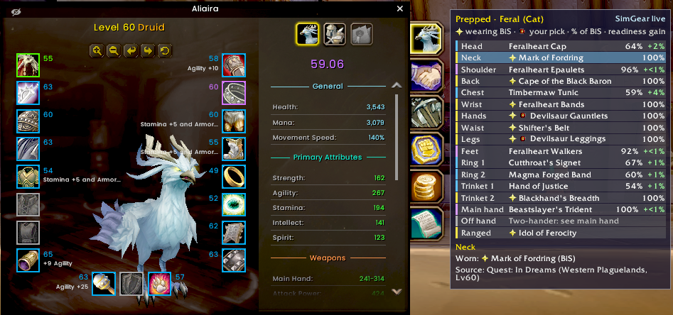
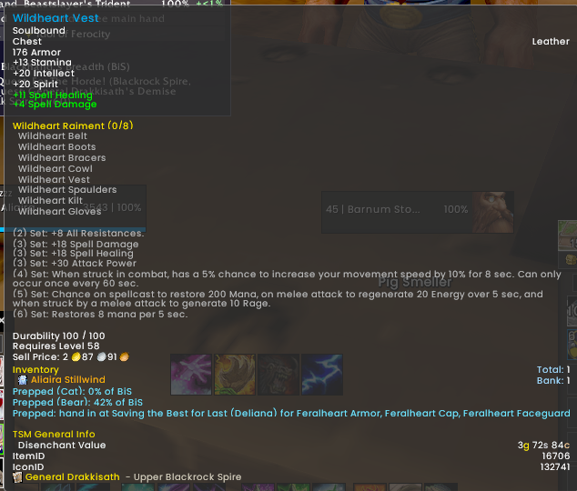
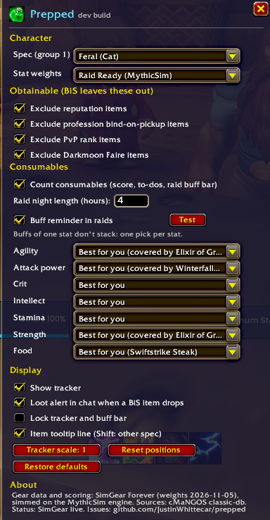

## Know you're ready before raid night

**Prepped** turns everything you bring to a raid (gear, enchants and consumables) into **one readiness score**, then tells you exactly what to do next to raise it, biggest gain first.

Built for **World of Warcraft: Forever**, on top of [SimGear Forever](https://www.curseforge.com/wow/addons/simgearforever)'s gear scores and item data.

**Source code, issues and releases:** [github.com/JustinWhittecar/prepped](https://github.com/JustinWhittecar/prepped)

## Features

### One score, one to-do list

- **Prep %** in the tracker: your gear, enchants and consumables against Pre-raid best-in-slot for your spec.
- **Raid now %** inside a raid: the same score, counting the buffs you actually have up.
- A **to-do list sorted by gain**: each upgrade, enchant and missing consumable shows how much readiness it adds (*+3%*). A slot's enchant always comes after the item it goes on.

### Pre-raid best-in-slot, your way

- BiS per slot, picked with SimGear's simmed scoring, including set bonuses and Forever's server-only tier 0.5 sets.
- **Your picks**: right-click a slot to target something else (a cheaper BoE, say). The score and to-dos follow your choice.
- **Filters** for reputation, profession-only, PvP rank and Darkmoon Faire items. Raid loot and items Forever doesn't have are never picked.
- A **slot panel** beside your character sheet: worn vs BiS for every slot, with where to get each item.

### Tier 0.5, every class

- Each tier 0.5 piece names the quest that gives it and the dungeon set pieces you still need to hand in.
- Hand-in items get a tooltip line, so a Wildheart Kilt never gets vendored, and the loot alert speaks up when one drops.

### Consumables and raid buffs

- A consumable plan sized to your raid night length. Buffs of the same stat don't stack on Forever, so you pick one per stat.
- A **buff reminder bar**: click a button to use what's missing. Show it in instances only (raids and 5-player dungeons), always, or never. Hidden in combat.
- Don't bother with consumables? Switch them off and the score is gear and enchants only.

### And also

- **Tooltips**: % of BiS and the readiness an item would add, for your spec (hold Shift for your other one).
- **Loot alert** in chat when a BiS item or tier 0.5 hand-in drops or comes up for roll.
- **Onyxia attunement**: a blocker line with your progress through the chain.
- **Stat weights**: SimGear's simmed weights, a preset, or your own.

## Getting started

1. Install [SimGear Forever](https://www.curseforge.com/wow/addons/simgearforever) and Prepped.
2. Log in on a level 60 character. The tracker appears; **/prep** shows or hides it.
3. Open the options with **/prep options** or the gear icon on the tracker.

Prepped ships with a snapshot of SimGear's data, so it keeps working if SimGear's class data is missing or changes shape.

## Commands

| Command | What it does |
| --- | --- |
| `/prep` | Show or hide the tracker |
| `/prep options` | Open the options |
| `/prep spec <name>` or `auto` | Choose the spec for this talent group, or detect it |
| `/prep pick <slot> <item link>` or `auto` | Set your own target for a slot, or go back to Prepped's BiS |
| `/prep weights` | Show or set stat weights |
| `/prep buffs never`, `instances` or `always` | When the buff reminder bar shows |
| `/prep reset` | Put the tracker and buff bar back where they started |
| `/prep debug` | Show what Prepped sees, for bug reports |

## Status and feedback

**Beta**, English only. The content target is Pre-raid; raid loot targets will follow once their loot data exists.

Found a bug or a wrong BiS pick? Open an issue on [GitHub](https://github.com/JustinWhittecar/prepped/issues) and include the output of **/prep debug**.

## Credits

Gear data and scoring: [SimGear Forever](https://www.curseforge.com/wow/addons/simgearforever) by Flavius and contributors, simmed with MythicSim. Quest, reputation and attunement data: [cMaNGOS classic-db](https://github.com/cmangos/classic-db). Prepped is free software under the GNU GPL v3 or later; source on [GitHub](https://github.com/JustinWhittecar/prepped).
